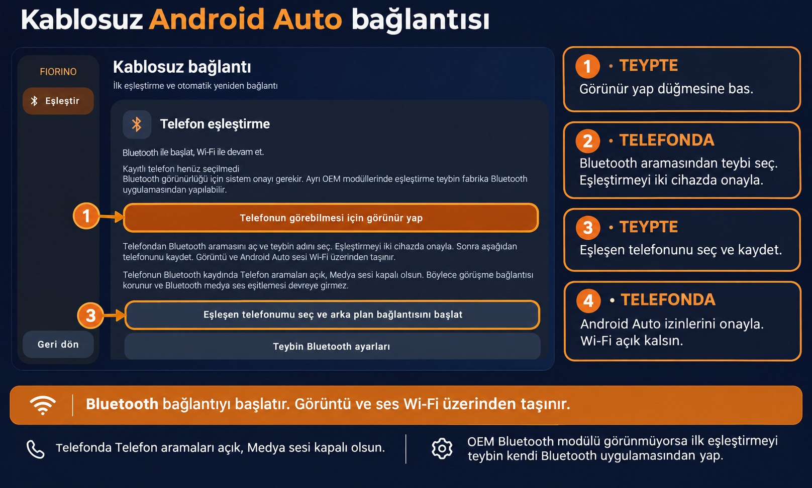
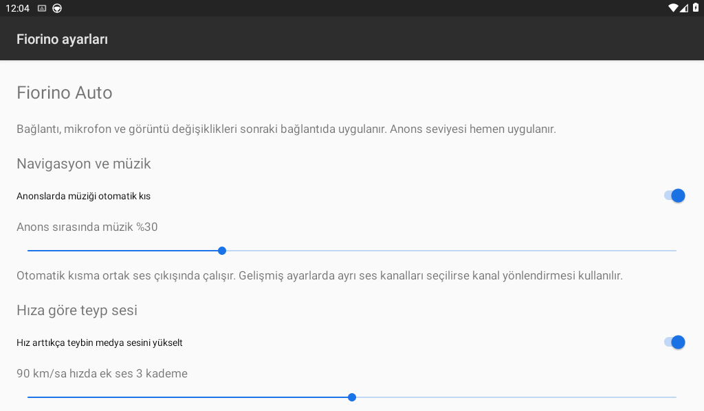
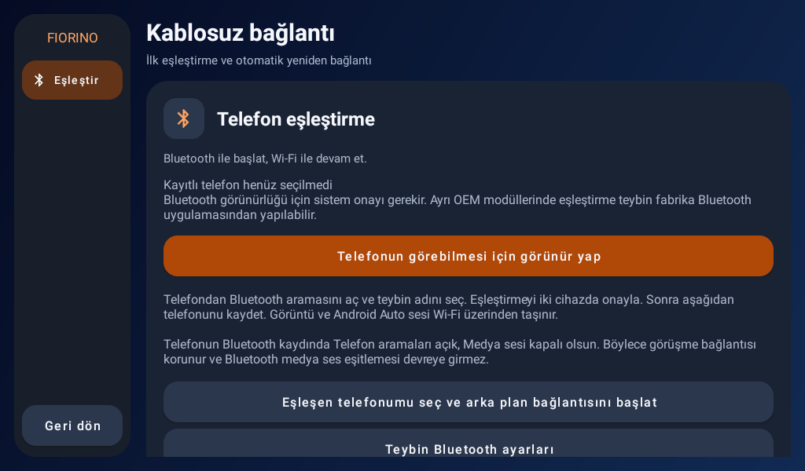
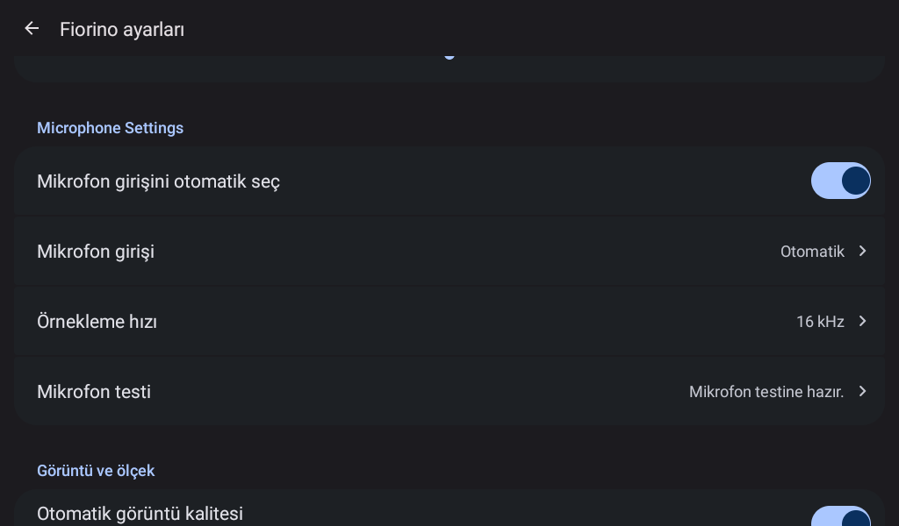

# Fiorino Auto

Fiat Fiorino'daki Android 7.1 / Rockchip PX3 veya PX5 teyp için Android Auto alıcısı. Open Headunit'in `ae74788d8312dd7a735775ddc21370f1741a7af1` sürümünden türetilmiştir. AGPL-3.0 lisansı ve önceki yazarların telif bildirimleri korunmuştur. Önceki proje belgeleri [README_UPSTREAM.md](README_UPSTREAM.md) dosyasındadır.

## Kurulum

1. APK'yı teybe yükleyin. Telefonda Android Auto bulunmalı. Mikrofon, Bluetooth/konum ve otomatik başlatma izinlerini verin.
2. **Ayarlar → Fiorino ayarları → Native Android Auto kurulumu** ekranında **Otomatik Native alıcıyı etkinleştir** seçeneğine dokunun.
3. **Telefon için görünür yap** seçeneğini açın. Telefondan teybi bulup eşleştirmeyi iki cihazda onaylayın. OEM modülü Android'e görünmüyorsa ilk eşleştirmeyi teybin fabrika Bluetooth uygulamasından yapın.
4. Uygulamada **Eşleşen telefonu seç** satırından telefonunuzu kaydedin.
5. Kurulum bitince ayarlardan çıkın. Telefonda Android Auto izinlerini onaylayın. Wi-Fi açık kalsın. Bluetooth kaydında **Telefon aramaları açık, Medya sesi kapalı** olsun.

Native profil açılışta ve uykudan dönüşte bağlantıyı hazırlar, kopma sonrasında alıcıyı dinlemede tutar. İlk eşleştirme ve sistem izinleri kullanıcı onayı gerektirir. USB Host portunda veri kablosuyla kullanım da korunur.



## 1.3.2 bağlantı ve ekran ayarları

**Ayarlar → Fiorino ayarları → Kablosuz bağlantı profili** bölümünde yalnızca 2,4 GHz destekleyen PX3 teyp için **2,4 GHz araç — 480p / 30 FPS** seçin. Bu işlem hem Wi-Fi Direct hem hotspot bandını 2,4 GHz seçer, H.264 ve AAC kullanır, otomatik 720p yükseltmesini kapatır. Mevcut oturumun Wi-Fi ağı değiştirilmez. Android 7.1 üretici sürücüsü kanal/bant isteğini dikkate almayabilir; gerçek bant araç üzerinde kontrol edilmelidir. **Otomatik** destek varsa 5 GHz dener ve platformun yedek bağlantısını korur. **5 GHz** yalnızca bunu destekleyen cihaz içindir.

Küçük yazılar için **Arayüz boyutu / DPI → Büyük (190)** veya **Çok büyük (220)** seçin. 480p'de Android Auto yerleşim sınırı DPI'yı aşağı çekebilir. **Seçtiğim DPI boyutunu uygula** anahtarı bu sınırı kaldırır. Daha az içerik veya farklı menü düzeni oluşabilir. Değişiklikler sonraki bağlantıda uygulanır.

Uyandırma öncesi Bluetooth cihaz taraması durdurulur. Bu, tarama açıkken RFCOMM kurulumunun radyo zamanını paylaşmasını azaltmayı amaçlar. Deneme süreleri loga yazılır. Dayanak: [Android Bluetooth bağlantı belgesi](https://developer.android.com/develop/connectivity/bluetooth/connect-bluetooth-devices). Bu değişiklik ölçülmüş bir toplam bağlantı süresi garantisi değildir.

Canlı veya kurulmakta olan yansıtma sırasında geçici boş Wi-Fi Direct grup yanıtı ağı yeniden oluşturmaz. Otomatik Wi-Fi kurtarma, hazırlık sonrasında da oturum durumunu tekrar kontrol eder. Donanım/parazit kaynaklı kopmalar için PX3 üzerinde test gerekir.

## Bu sürümdeki eklemeler

- İlk çalıştırmada 480p / 30 FPS / H.264, Türkçe dil ve kontak/ekran uyanışında otomatik başlatma.
- Dinamik ses odağı modunda ortak çıkış ve gerçek çalınan navigasyon/asistan sesine göre medya kısma. Başlangıç seviyesi %30, kullanıcı tarafından %0–100 ayarlanabilir. Android sistem ses düğmesinin seviyesi değiştirilmez.
- Kullanılmayan navigasyon kanalı müziği kısmaz. Bitiş bildirimi kaybolsa da ses tamponu boşalınca kısma kalkar. Yeni oturum kendi ses durumuyla başlar. Diğer uygulamaların veya OEM donanımının uyguladığı ses kısması bu denetimin dışındadır.
- Otomatik mikrofon, açılabilen VOICE_COMMUNICATION, MIC, DEFAULT veya VOICE_RECOGNITION kaynağını dener. 16 kHz açılamıyorsa 48 kHz kayıt denenir ve Android Auto'nun 16 kHz formatına dönüştürülür. Sessizlik giriş değiştirmek için tek başına yeterli değildir. Elle giriş ve örnekleme hızı ayarı korunur.
- Kısa mikrofon testi ses dosyası kaydetmeden tepe seviyesini gösterir. Bluetooth SCO ve HFP görüşme mikrofonu gerçek görüşmeyle ayrıca denenmelidir.
- Otomatik görüntü kalitesi yeterli uzunluktaki kablosuz oturum sonunda kare kaybı ve render atlamalarını değerlendirir. %5 ve üzeri kayıpta sonraki bağlantı 480p olur. En fazla %1 kayıplı üç oturum sonunda 720p denenir. Manuel seçim otomatiği kapatır. Protokol doğrudan video bitrate kontrolü sunmaz. Kalite değişimi mevcut oturumu kesmez.
- DPI hazır değerleri, özel DPI ve mevcut gelişmiş görüntü ayarları.

## 1.3.1 — Native seçiminin korunması

Eski bağlantı bayrakları yeni Native seçimini Headunit Sunucusu moduna geri çevirebiliyordu. Kaydedilmiş bağlantı modu artık önceliklidir. Yeni seçim yapıldığında eski bayraklar birlikte temizlenir. Eski kayıtlar bir kez taşınır ve seçim sonraki okumalarda sabit kalır.

Bu güncellemeden sonra Native kullanım için **Otomatik Native alıcıyı etkinleştir** seçeneğini tekrar uygulayın. Native bağlantı telefondaki geliştirici Headunit sunucusunu gerektirmez. Telefon-teyp Bluetooth başlangıç iletişimi ve Wi-Fi ağı cihazda ayrıca doğrulanmalıdır.

## 1.3 — Standart ayar menüsü ve Native alıcı profili

Fiorino ve telefon bağlantısı ekranları, uygulamanın diğer ayar sayfalarıyla aynı liste, kategori başlığı, anahtar, kaydırıcı ve seçim pencerelerini kullanır. Uygulamanın dil ve tema altyapısı bu ekranlarda da uygulanır.

Native kurulum seçeneği Native AA, açılışta/uyanışta başlatma ve arka planda yeniden bağlantıyı birlikte ayarlar. Bağlantı kopunca alıcının kapanmasını ve otomatik Bağımsız Mod başlamasını kapatır. Seçilen telefon ve mevcut mikrofon, ses ve DPI tercihleri korunur. Kayıtlı telefon Bluetooth üzerinden başlangıç iletişimini kurar, Android Auto görüntüsü ve sesi Wi-Fi üzerinden taşınır. Teybin Bluetooth modülü ve gerçek Android Auto el sıkışması araçta doğrulanmalıdır.

Yerel derleme ve 4.795 test geçti. Native profilin tekrar uygulanması, kayıtlı telefonu koruması, ses/görüntü ayarlarını koruması ve geçersiz adresi ayarlara dokunmadan reddetmesi Android 7.1 ortamında test edildi.

## 1.2 — Ana ekranla uyumlu ayarlar

Fiorino ayarları ve telefon eşleştirme ekranları koyu lacivert zemin, yuvarlatılmış kartlar, turuncu vurgular ve büyük dokunma alanlarıyla yenilendi. Ses, Hız, Mikrofon, Bağlantı, Görüntü ve Cihaz bölümleri soldaki menüden açılır. Genel ayarlar ekranı da koyu temada gösterilir. Seçim pencereleri aynı temayı kullanır. Mevcut ayarlar korunur.

Görünür yerel emülatörde arayüz kontrol edildi. 4.793 mevcut test ve Android 7.1 üzerinde menü yazılarının sığmasını ve kontrol geri çağrılarını doğrulayan iki yeni arayüz testi geçti. Güncel ekran görüntüleri aşağıdadır.

## 1.1 — Hıza göre teyp sesi ve uygulamadan eşleştirme

Hıza göre ses ayarı yalnızca teybin Android medya sesine uygulanır. Telefonun ses ayarını değiştiren Wi-Fi veya AVRCP komutu gönderilmez. Teybin canlı GPS hızı kullanılır. 90 km/sa hızda varsayılan artış üç kademedir, 0–6 arasında seçilebilir. Geçiş iki saniyede en fazla bir kademedir. GPS verisi beş saniyeden eskiyse ek ses kaldırılır. Elle sessize alma korunur ve ses düğmesiyle yapılan değişiklik yeni temel seviye kabul edilir. Görüşme sırasında ses yönetimi bekler. OEM amplifikatörü Android medya seviyesini kullanmıyorsa fiziksel ana ses ayrıca cihazda incelenmelidir.

Fiorino ayarları → Telefon eşleştirme ve arka plan bağlantısı ekranında teyp 180 saniye görünür yapılabilir. Telefonun Bluetooth aramasından teybi seçip sistem eşleştirmesini onaylayın. Ardından uygulamadan eşleşen telefonu seçin. Telefon, Native AA ve açılış/uyanış sonrası otomatik bağlantı için kaydedilir. Ayrı OEM Bluetooth modülü Android'e açılmıyorsa ilk eşleştirme fabrika uygulamasından yapılır. Desteklenen OEM eşleşme kayıtları seçim ekranına dahil edilir.

Telefonun Bluetooth kaydında **Telefon aramaları açık**, **Medya sesi kapalı** olsun. Android Auto medya aktarımı Wi-Fi üzerinden yapılırken Bluetooth medya ses eşitlemesi böylece devre dışı kalır. Teybin Bluetooth modülünün davranışı fiziksel araçta doğrulanmalıdır.

Çözünürlük bağlantı devam ederken değişmez. Otomatik kalite, bir oturumun ölçümlerini sonraki bağlantıda kullanır. DPI ve manuel çözünürlük değişiklikleri de yeniden bağlantıda uygulanır.

Derlemeler yerel Gradle/Android SDK ile yapılır. Bulut derleme kurulmamıştır. Depoda otomatik GitHub Actions derleme iş akışı bulunmaz.

## Arama sesi

Hedef, aramaların araç hoparlörleri ve araç mikrofonundan yapılmasıdır. Bunun için telefon-teyp HFP bağlantısı gerekir. Önce Android Auto kapalıyken teybin Bluetooth uygulamasında gelen/giden arama deneyin. Sonra Android Auto açıkken tekrar deneyin. Teybin OEM modülü görüşme mikrofonunu Android uygulamalarına açmayabilir. Asistan mikrofon ayarı HFP görüşmesinin mikrofonunu değiştirmez.

## Araçta doğrulama

- Telefon kilitliyken beş tam açılış ve beş uykudan dönüş. Her seferinde bağlanma süresini kontrol edin.
- Rota başlamadan bağlantı kurun. Müzik normal ses düzeyinde başlamalı.
- Tek ve peş peşe navigasyon anonsları. Sonrasında ses eski seviyesine dönmeli.
- Anons sırasında ses düğmesini çevirin. Yeni kullanıcı seviyesi korunmalı.
- Anons sırasında çağrı alın. Karşılıklı sesi ve arama sonrasında müziği kontrol edin.
- Anons sırasında bağlantıyı kesin, yeniden bağlanın. Kısık ses taşınmamalı.
- 30 dakika navigasyon ve müzik. Dokunma, ses kesintisi, sıcaklık ve yeniden bağlantı davranışını kontrol edin.

Gerçek teyp ve telefon üzerinde bu kontroller henüz yapılmadı. APK bir önizleme sürümüdür. CarPlay henüz uygulanmadı. Bağlantı ve oturum ayrımı kaynak projedeki transport yapısında korunur, CarPlay için ayrı protokol/donanım incelemesi gerekir.

## Derleme

JDK 21, Android SDK 36, CMake 3.22.1 ve Android NDK gerekir. Bu çalışma NDK 28.2.13676358 ile derlenmiştir. SDK yolunu `ANDROID_HOME` ile belirtin.

```sh
./gradlew :app:assembleGithubDebug :app:testGithubDebugUnitTest -PfiorinoNdkVersion=28.2.13676358
./gradlew :app:assembleGithubRelease -PfiorinoNdkVersion=28.2.13676358
```

Uygulama kimliği `com.yusufcelik.fiorinoheadunit`. APK hem armeabi-v7a hem arm64-v8a içerir. İmzalı release için git tarafından dışlanan `key.properties` dosyasında storeFile, storePassword, keyAlias ve keyPassword alanlarını tanımlayın. Güncellemeler için aynı imza anahtarını saklayın. Anahtarlar depoya eklenmemelidir.

## Kaynaklar

- https://github.com/andreknieriem/open-headunit
- https://headunit.andrerinas.com/guides/wireless/
- https://headunit.andrerinas.com/guides/settings/
- https://developer.android.com/media/optimize/audio-focus

## Ekran görüntüleri

1024×600 yerel Android 11 emülatöründen alınmıştır. Android Auto telefon yansıtması ve gerçek araç bağlantısı bu görsellerde açık değildir.






## CarPlay deneme modülü

Yerel `carplay-lab` prototipi ve `carplay-engine` alıcı motoru eklendi. Ana Android Auto APK'sı ayrı kalır. **Henüz gerçek iPhone CarPlay bağlantısı doğrulanmadı; genel kaynak APK aksesuar kimliği içermez.** Kurulum, yerel derleme, doğrulama ve kalan işler [CarPlay Lab notlarında](docs/CARPLAY-LAB.md) açıklanır.
