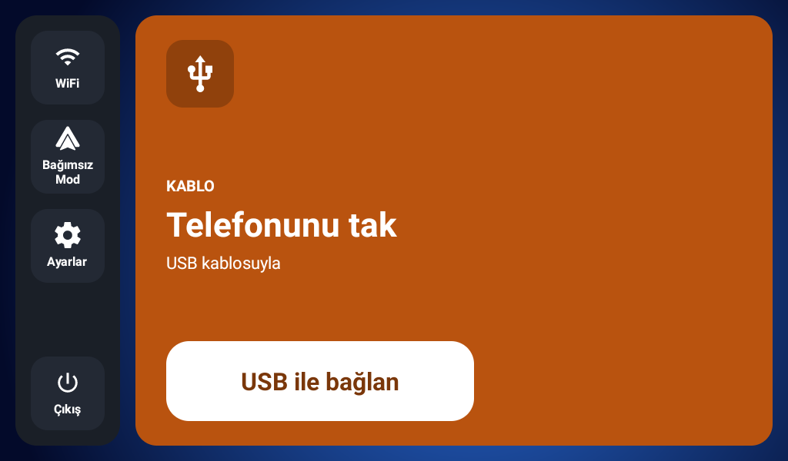
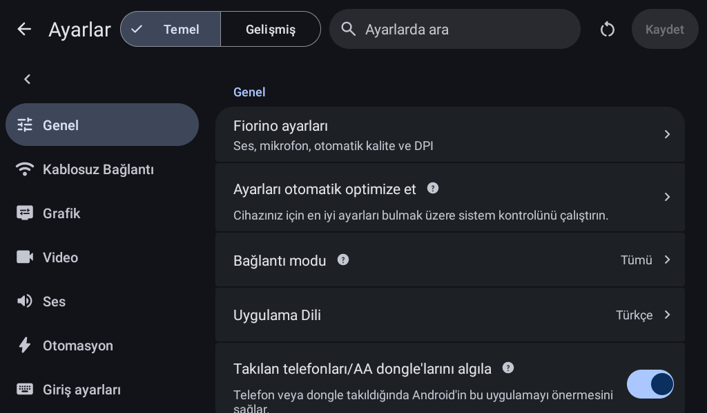

# Fiorino Auto

**Android baş üniteleri için tek uygulamada Android Auto ve deneysel CarPlay alıcısı.**

[](https://github.com/yusufcelalcelik/carplay/releases/tag/v1.4.4-preview)
[](LICENSE)
[](docs/BUILDING.md)

Fiorino Auto, Fiat Fiorino'daki Android 7.1 tabanlı multimedya için geliştiriliyor. Telefon seçimi, kablosuz bağlantı, ses/mikrofon ayarları ve ekran ölçeklendirmesini tek uygulamada toplar. Android Auto ve CarPlay aynı anda iki görüntü açmaz; seçilen telefonun alıcısı bağlantıyı sahiplenir.

**Proje önizleme aşamasındadır.** Gerçek iPhone ile CarPlay kontrol ve görüntü bağlantısı Note 9 üzerinde doğrulandı. Hedef araçtaki PX3/PX5 platformu henüz cihaz bilgisiyle kesinleştirilmedi; gerçek teyp, kontak döngüsü ve görüşme sesi testleri bekliyor.

[APK sürümleri](https://github.com/yusufcelalcelik/carplay/releases) · [Kurulum](docs/GETTING-STARTED.md) · [Yerel derleme](docs/BUILDING.md) · [Sorun bildir](https://github.com/yusufcelalcelik/carplay/issues)

## Hangi APK?

| Paket | Kullanım | CarPlay durumu |
| --- | --- | --- |
| Genel `fiorino-auto-…-preview.apk` | GitHub Releases; Android Auto ve ortak arayüz | Aksesuar kimliği içermez; yeni cihaza kurulması tek başına CarPlay'i hazır etmez. |
| `…-local-carplay-test.apk` | Ayrı hazırlanan yerel deney | Geçerli yerel kurulum girdisiyle test edilir; genel release'e yüklenmez. |

CarPlay'in keşif listesinde görünmesi, eşleşmesi ve görüntü oturumu açması farklı aşamalardır. Geçersiz/eksik yerel kimlikte uygulama medya bağlantısını başlatmaz. Testte çalışan bir kimlik, Apple onaylı bir ürün olduğumuz anlamına gelmez. [CarPlay kurulum ve provizyon açıklaması](docs/GETTING-STARTED.md#carplay).

## Özellikler

- **Ortak telefon seçimi:** Android/iPhone tercihini hatırlar; kayıtlı iPhone için doğrudan CarPlay açılışı sunar.
- **Kablosuz Android Auto ve USB:** Native AA başlangıcı ve mevcut kablolu alıcı yolu; Self Mode ayrıca bulunur.
- **CarPlay oturum hizmeti:** Ekranın yaşam döngüsünden bağımsız bağlantı; açılış, Bluetooth ve uyanış tetikleri; kopma sonrası 2–60 saniye aralıklarla yeniden deneme.
- **Ekrana uyum:** CarPlay için en çok 800×480 / 30 FPS tuval, ekran oranına göre boyutlandırma, tam ekran ve çentik düzenlemesi. AA için hazır/özel DPI; 260 DPI seçeneği dahil.
- **Telefon kayıtları:** Uygulama tercihlerini ve CarPlay yetkilendirmelerini sıfırlama; sistem Bluetooth eşleşmelerine geçiş.
- **AA ses ayarları:** Navigasyon/asistan sırasında medya kısma, otomatik mikrofon kaynağı ve örnekleme hızı seçimi, alıcının Android medya seviyesine GPS hızına göre ayar.
- **2,4 GHz teyp profili:** AA için 480p / 30 FPS / H.264; CarPlay alıcısında 2,4 GHz kanal 6. Gerçek radyo/sürücü uyumu cihazda doğrulanır.

Telefon uygulamalarının sunduğu özellikler ve araç donanımı gerektiren işlevler ayrıdır. **CarPlay Ultra'nın bütün gösterge/araç işlevleri desteklenmiş sayılmaz.** Siri/Gemini ile fiziksel teyp sesini artırma henüz uygulanmış/doğrulanmış değildir. [Ayrıntılı özellik ve doğrulama matrisi](docs/FEATURE-COMPATIBILITY-2026.md).

## Uyumluluk ve test durumu

| Bileşen | Durum |
| --- | --- |
| Android Auto alıcısı | Android 5.0+ / API 21; ARM32 ve ARM64 |
| CarPlay alıcısı | Android 7.0+ / API 24; ARM32 ve ARM64 |
| Hedef teyp | Android 7.1, Rockchip olasılığı; tam MCU/kart tespiti ve araç testi bekliyor |
| Masa başı test | Redmi Note 9 alıcı, Redmi Note 12 Android gönderici, gerçek iPhone 14 Pro Max |
| 1.4.4 doğrulaması | 4.811 ana uygulama + 16 ortak CarPlay testi; yerel build |

Bu sayılar **5 Kasım 2026 tarihli 1.4.4 koşumuna** aittir; sürekli CI rozeti veya bütün donanımlar için uyumluluk garantisi değildir. Tekil CarPlay bağlantı ölçümleri [test notlarında](docs/CARPLAY-LAB.md) bulunur.

Google'ın standart kablosuz AA koşullarında telefonun 5 GHz desteği bulunur. Buradaki 2,4 GHz teyp profili özel bir uyumluluk denemesidir. Modern Android, arka plandan ekran açma ve mikrofon erişimini sınırlar. [Kurulum ve sorun giderme](docs/GETTING-STARTED.md).

## Hızlı başlangıç

1. [Bu deponun Releases sayfasından](https://github.com/yusufcelalcelik/carplay/releases) uygun APK'yı seçin; genel ve yerel CarPlay paketlerinin farkını yukarıdan kontrol edin.
2. Alıcıya kurun; Bluetooth, Wi-Fi/konum ve kullanacağınız mikrofon izinlerini verin.
3. Uygulamadaki telefon seçicisinden **Yeni telefon eşleştir** ile Android Auto veya CarPlay akışını açın; telefonun gösterdiği onayları tamamlayın.
4. Kayıtlı telefonu seçin. CarPlay otomatik bağlantısını açtıysanız sonraki uygulama açılışları kayıtlı iPhone'a gider. **Telefon değiştir** ile yeniden seçim yapılır.

[Android Auto, CarPlay, USB, DPI ve arama sesi adımları →](docs/GETTING-STARTED.md)

## Arayüz

Aşağıdaki görüntüler yerel 1024×600 Android emülatöründeki uygulama arayüzüne aittir; gerçek telefon projeksiyonu veya araç testi göstermez. Eski ekran görüntülerinde son sürümdeki menü eklemelerinin tamamı görünmeyebilir.

<p>
  
  
</p>

## Geliştirme

JDK 21, SDK 36, NDK 28.2.13676358 ve CMake 3.22.1 ile **yerelde** derlenir. Bulut derleme veya GitHub Actions iş akışı kullanılmaz.

```sh
./gradlew :app:assembleGithubDebug \
  -PfiorinoNdkVersion=28.2.13676358 --console=plain
```

[Derleme, test ve imzalama](docs/BUILDING.md) · [Katkı rehberi](CONTRIBUTING.md) · [Değişiklik geçmişi](CHANGELOG.md) · [Yol haritası](ROADMAP.md)

## Donanım ve direksiyon tuşları

Android uygulaması yalnızca kendisine ulaşan tuş olaylarını işleyebilir. Dirençli KEY girişleri ile araç CAN hattı aynı şey değildir. 2017 Pop araçta sonradan takılmış Premio direksiyonun kablolama ve sinyal yolu ayrıca kontrol edilmelidir. [Fotoğrafa dayalı donanım incelemesi ve birlikte debug planı](docs/HARDWARE-AND-STEERING.md).

## Lisans ve kaynaklar

Fiorino Auto, [Open Headunit](https://github.com/andreknieriem/open-headunit) kaynaklarından türetilmiştir; ana projenin [AGPL-3.0 lisansı](LICENSE) ve önceki yazarların bildirimleri korunur. CarPlay motoru [DiPlay](https://github.com/shihabal3amri/DiPlay) kaynaklarından alınmıştır; [motorun GPL-3.0 lisansı ve kaynak kaydı](carplay-engine/UPSTREAM.md) ayrıdır. Kaynak kod lisansı, üçüncü taraf aksesuar kimliklerinin dağıtım yetkisi olarak yorumlanmaz.

[Upstream README](README_UPSTREAM.md) · [Upstream değişiklik geçmişi](CHANGELOG_UPSTREAM.md) · [Veri işleme açıklaması](PRIVACY.md)

Android Auto, CarPlay ve ilgili ürün adları sahiplerinin markalarıdır. Bu depo Apple, Google veya Fiat'ın resmî bir ürünü değildir.
