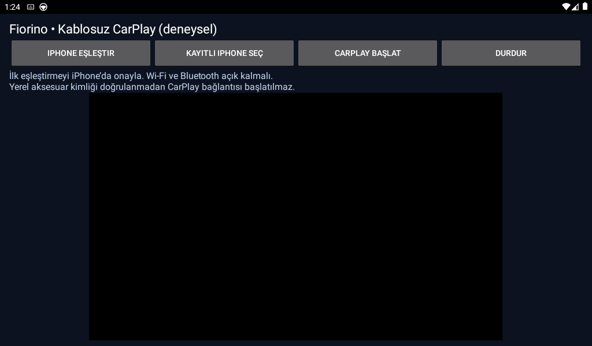

# Kablosuz CarPlay denemesi

## Durum

**1.4.3 kaynak durumu:** Android Auto ve CarPlay tek ana APK içindedir (`com.yusufcelik.fiorinoheadunit`). `carplay-ui` ortak arayüzü ve CarPlay foreground hizmetini, `carplay-engine` protokol motorunu içerir. Lab yalnız ayrı geliştirme girişidir. CarPlay Android 7.0+, AA minSDK21; PX3/Android7.1 donanım testi henüz yapılmadı.

**Gerçek CarPlay kontrol ve görüntü bağlantısı doğrulandı.** Yerel deneysel kimlikli 1.4.0 testinde iPhone14ProMax kontrol oturumu ve çizilen video karesi verdi; Siri etkinleştirildikten sonra Haritalar açıldı. 1.4.1'de foreground hizmeti ve tam ekran gerçek Note9'da açıldı: kontrol 7.145ms, ilk kare 7.878ms. Bunlar tekil bağlantı ölçümleridir. Genel kaynak APK bu yerel kimlik girdisini içermez; yeni cihaza genel APK kurmak tek başına CarPlay hazırlamaz. Başarılı yerel deney Apple onaylı ürün veya kimlik dağıtım yetkisi anlamına gelmez.

Ortak seçici Android/iPhone türünü MAC adresine göre kaydeder. **Kayıtlı CarPlay otomatik bağlantısı etkinse** uygulama simgesinden açılış doğrudan kayıtlı iPhone ekranına döner; her seferinde telefon sorulmaz. İlk kurulumda ve **Telefon değiştir** düğmesinde ortak seçici kullanılır. Android Auto seçilince CarPlay hizmeti ve eski ağ temizliği bitmeden AA başlamaz. USB/Self seçimi de CarPlay'i bırakır.

`CarPlaySessionService` Activity'den bağımsız kontrol/medya sahibidir. Ekran arkaya gidince yalnız video yüzeyi ayrılır. Boot/unlock/Bluetooth ve çalışan hizmette ekran uyanışı tetikleri kayıtlı iPhone'u kullanır. Hata sonrası 2/5/10/20/40/60sn aralıkla yeniden denenir; bağlı/kurulmakta olan oturum sırf Bluetooth veya ekran uyandı diye yenilenmez. Durdur düğmesi otomatik denemeyi bekletir. Modern Android arka plan UI/mikrofon kısıtları geçerlidir; API29+ bildirimden ekranı açmak gerekebilir. Android7.1'de kontrol oturumu geldiğinde CarPlay ekranı açılabilir. Gerçek kontak döngüsü ve tekrarlı kopma testi bekler.

1.4.2'de ekran profili kullanılabilir yatay boyuttan hesaplanır; en çok800×480, 16'nın katları. Örneğin 2340×1080 test telefonu için800×368. Bu sabit800×480 oranının geniş ekrandaki yan boşluklarını azaltır. 30FPS/H.264 ve 2,4GHz kanal6 korunur. Ana SurfaceView ve dokunma koordinatları aynı oranı kullanır. Ekran geometrisi oturum başlangıcında seçilir; canlı oturumda rastgele yeniden görüşülmez.

Alıcı MAC adresi API'den gizlenirse CarPlay ekranındaki **Alıcı adresi** satırına teybin gerçek Bluetooth adresi bir kez kaydedilir; telefonun adresi kullanılmaz. Adres her bağlantıda yeniden girilmez. Yerel test sürümü ayrıca aşağıdaki ADB kurulum girdisini destekler.

DiPlay'ın `615b32ce0b40cd0b99ce94ba23a512001553684f` sürümündeki `shared/` motoru `carplay-engine` içine alındı. iAP2 Bluetooth başlangıcı, Wi-Fi Direct, AirPlay kontrolü, video/ses ve dokunma motoru bağlandı. Kaynak/lisans bilgisi [UPSTREAM.md](../carplay-engine/UPSTREAM.md) dosyasındadır. Ayrı lisanslı BYD HUD görselleri alınmadı. Upstream demo Android Auto servisi manifestten çıkarıldı.

Aşağıdaki 0.1.0 Lab ekran görüntüsü tarihsel prototiptir; yeni cihaz kanıtı yukarıdadır. Kaynak APK hiçbir aksesuar kimliği içermez. Kimlik yoksa veya geçersizse yansıtma/ağ kurulumu başlatılmaz; kullanıcıya neden bildirilir. Yerel anahtarın sertifikasıyla eşleşmesi, iPhone'un onu kabul ettiğini kanıtlamaz.



## Yerel derleme

Ana projeyle aynı JDK 21, SDK 36 ve NDK 28.2.13676358 kullanılır. Cloud build gerekmez.

```sh
./gradlew :carplay-lab:assembleDebug :carplay-ui:testDebugUnitTest \
  :carplay-engine:testDebugUnitTest \
  --tests '*MfiAuthenticationClientTest' --tests '*Iap2*' \
  --tests '*AirPlayCryptoTest' --tests '*WifiP2p*' \
  --tests '*PairSetupTest' --tests '*PairVerifyTest' \
  -PfiorinoNdkVersion=28.2.13676358
```

Çıktı: `carplay-lab/build/outputs/apk/debug/carplay-lab-debug.apk`. Debug imzasıdır. Motorun JDK HTTP sunucusu kullanan host testleri için yalnızca test derleme sınıf yoluna yerel JDK API'si eklenir; APK'ya eklenmez. İki SoftAP testindeki Android-hidden setter çağrıları SDK 36 ile derlenebilmesi için reflection kullanır.

İsteğe bağlı, açıkça sağlanmış yerel aksesuar girdileri:

```text
/absolute/private/runtime-assets/
└── offline-mfi/
    ├── identity.pk8
    └── certificate.p7b
```

Bu iki dosya dışındaki girdiler build sırasında reddedilir. Dosyalar, anahtarlar ve kimlik içeren özel APK genel kaynak deposuna veya genel release'e eklenmemelidir.

```sh
FIORINO_CARPLAY_AUTH_ASSETS=/absolute/private/runtime-assets \
  ./gradlew :carplay-lab:assembleDebug -PfiorinoNdkVersion=28.2.13676358
```

Sağlayıcı, yerel P-256 aksesuar imzası kullanır. Rastgele/self-signed test kimlikleri iPhone'a kabul edilmiş aksesuar kimliği olarak sunulmaz. Sentetik test girdileri yalnızca birim testlerinde üretilir. Upstream'in yayımladığı deneysel APK'daki Carlinkit kimliği bu projeye alınmadı; kaynak kod lisansı bu kimliği yeniden lisanslamaz.

## Cihaz denemesi

1. Diğer yansıtma uygulamalarını durdurun. Lab uygulaması yalnızca ekranda açıkken çalışır; arka planda/kontakta otomatik CarPlay desteği henüz eklenmedi.
2. Android tarafında Wi-Fi, Bluetooth, konum ve mikrofon izinlerini sağlayın.
3. “iPhone eşleştir” ile görünürlüğü açın; iPhone'daki sistem eşleştirmesini onaylayın. “Kayıtlı iPhone seç” ile hedefi saklayın.
4. Normal uygulama API'leri gerçek yerel Bluetooth adresini gizliyorsa ADB ile okunan gerçek adres, yalnızca lab kurulumunda `hostBluetoothMac` intent girdisiyle verilebilir. Yer tutucu `02:00:00:00:00:00` kabul edilmez. Adres kaynak koda sabit yazılmaz.
5. Doğrulanabilir yerel aksesuar girdisi ve gerçek Bluetooth adresi hazırken “CarPlay başlat” seçilir. Wi-Fi Direct kanal 6, 800×480 H.264, 30 FPS başlangıç ayarlarıdır. 2,4 GHz araçta gerçek performans henüz ölçülmedi.
6. iPhone'daki CarPlay onayını tamamlayın. Listede görünme, eşleşme, kontrol oturumu ve görüntü/ses ayrı aşamalardır. Her aşama cihazda doğrulanmalıdır.

Ekrandan ayrılma ve “Durdur” alıcıyı kapatır. Bu prototipte foreground servis, kontakta başlama, çağrı/ses yönlendirmesinin araç üzerinde doğrulanması ve ana uygulamaya aktarım tamamlanmış değildir.

## Bu adımda doğrulananlar

- Yerel debug APK derlendi ve imzası doğrulandı.
- 92 hedefli motor testi ve 5 Lab testi geçti (2 ön kontrol, 3 keşif kayıt yaşam döngüsü testi). Motorun tüm upstream testleri çalıştırılmış sayılmaz.
- Android 11, 1024×600 yerel emülatöründe Lab kuruldu ve gerçek ekranı açıldı.
- Note 9'un Downloads klasörüne test APK'sı kopyalandı. Fiziksel Lab kurulum/açılışı henüz doğrulanmadı; cihaz son kontrolde kilitli/uykudaydı.
- Xcode cihaz envanterinde fiziksel iPhone çevrimdışıydı. Simülatör envanterinin görünmesi gerçek iPhone veya Bluetooth CarPlay testi değildir.

## Devam edilecekler

Önce geçerli yerel aksesuar provizyonu ve fiziksel iPhone erişimini çöz, gerçek el sıkışmasını kaydet. Bunlar olmadan “native CarPlay çalışıyor” veya “iPhone araç olarak tanıyor” sonucu bildirme. Kullanıcı uzaktayken fiziksel onay engel olursa uygulama içi Android Auto kablosuz eşleştirme akışı ve ölçülebilir performans iyileştirmeleriyle devam et. Note 12 kullanıcıyla dışarıda; alıcı olarak Note 9 kalacak.

## 0.1.1 — iPhone CarPlay menüsünden keşif denemesi

Kullanıcının hedefi iPhone → Genel → CarPlay → Kullanılabilir Araçlar ekranından alıcıyı seçmek. Önceden eşleşmiş bir iPhone'a giden bağlantı ile bu ilk keşif aynı aşama değildir. Apple, Bluetooth alt sisteminin servis keşfi/iAP2 yanında CarPlay desteğini EIR içinde ilan etmesini ister: [Apple WWDC17](https://developer.apple.com/videos/play/wwdc2017/717/).

Lab'daki **CarPlay keşif testi**, aksesuar tarafındaki iAP2 (`…decacaff`) ve CarPlay (`ec884348-cd41-40a2-9727-575d50bf1fd3`) servis kayıtlarını birlikte açar ve Android'in izin penceresiyle üç dakikalık görünürlük ister. Kimlik bilgisi gerektirmeyen, yalnızca keşif deneyidir. Bu moddaki gelen bağlantılar kapatılır; iAP2/MFi yanıtı veya görüntü/ses oturumu oluşturulmaz. Socket kaydının açılması EIR'nin iPhone tarafından görüldüğünü **kanıtlamaz**. Gerçek araç listesi, Android Bluetooth yığını ve iPhone üzerinde ayrıca denenmelidir. Kayıt çifti atomik açılır; ikinci kayıt başarısızsa ilk kayıt da kapanır. Durdur/çıkış ve süre sonu kayıtları kaldırır.

Aksesuar/iPhone UUID ayrımı için incelenen birincil uygulama: [catplay iAP2 kaynakları, 4487a6d](https://github.com/catplay-labs/catplay/blob/4487a6d85f2ced8c2a680e4d122a0dea2f294320/bluetooth/catplay_bt/src/iap2.rs). Bu aşamada cihaz sınıfı veya sistem Bluetooth kimliği değiştirilmez.

Tek APK içinde Android Auto ve CarPlay kullanımı son hedef olarak korunur. Mevcut Lab ayrı deneme paketidir; tek APK entegrasyonu henüz tamamlanmadı.

## Fiziksel keşif ve kurulum doğrulaması — 5 Kasım 2026

Kullanıcı, iPhone 14 Pro Max'in CarPlay araç listesinde Note 9'u gördüğünü bildirdi. Note 9'da gelen RFCOMM bağlantısı ve iPhone Bluetooth bağı da doğrulandı; iPhone uygulamada hedef olarak kaydedildi. Bu, keşif ve eşleştirme aşamalarını doğrular. Gelen bağlantının keşif testince kapatıldığı için görüntü/ses oturumu henüz doğrulanmış değildir.

0.1.1 debug APK'nın hash/imza kontrolleri ve emülatör kurulumu başarılıydı; Note 9'un dosyadan kurulum kayıtlarında `INSTALL_FAILED_INTERNAL_ERROR: Session relinquished`, doğrudan USB kurulumunda `INSTALL_FAILED_USER_RESTRICTED` görüldü. Kesin kök neden belirlenmedi. Ana Fiorino imzasıyla `debuggable=false` olarak derlenen 0.1.2 paketi kullanıcı tarafından başarıyla kuruldu ve cihazda sürümü doğrulandı. Önceki debug Lab sürümleri farklı imzalıdır; bu cihazdaki eski Lab zaten kullanıcı tarafından kaldırılmıştı.

0.1.2 release için `key.properties` gerekir; imza anahtarı kaynağa girmez. Genel dağıtımda `:carplay-lab:assemblePublicRelease` kullanılmalı; bu görev yerel kimlik girdisini ve APK içindeki kimlik dosyalarını reddeder. Yerel kimlik seçilirse sürüm adı `0.1.2-local-auth-test` olur. Böyle bir APK genel Releases'a yüklenmez.

Referans DiPlay 0.2.22 APK'sı resmi release SHA256 listesiyle doğrulanarak yalnızca yerel birlikte çalışabilirlik deneyi için incelendi. Deneysel kimlik dosyaları depo dışında, kullanıcıya özel yerel depolamada tutulur; kaynakta ve genel APK'da bulunmaz. Bu, yeni verilmiş Apple/MFi kimliği değildir. Geçerli yerel imza üretimi ile iPhone'un kabulünü ayrı ayrı doğrulamak gerekir.

## Birleşik sürüm doğrulaması (5 Kasım 2026)

Yerel `:app:assemblePublicGithubRelease`, `:app:assembleGithubDebug`, `:carplay-lab:assemblePublicRelease` başarılı. Ana uygulama 4.806, ortak CarPlay UI 6 test geçti. Yeni testler, iPhone servis kayıtlarının kullanıcı AA pinini geçersiz kılmasını, aksesuar/telefon UUID ayrımını ve ortak seçiciden gelen telefonun eski Lab favorisine üstünlüğünü kapsar. Emülatörde ortak seçici → yeni telefon → CarPlay akışı ana paket içindeki private Activity'ye açıldı; gerçek Note 9'da da aynı Activity ve sistem görünürlük penceresi gözlendi. Tam CarPlay görüntü/ses ve PX3 donanımı doğrulanmadı.

Herkese açık ana APK yalnızca `:app:assemblePublicGithubRelease` ile hazırlanır; bu görev yerel kimlik ortam girdisini reddeder ve APK içinde `assets/offline-mfi/` bulunmadığını denetler. Özel kimlikli APK genel `dist` veya Releases alanına konulmaz. Bu sürüm, seçilmiş iPhone için kimlik bulunmazsa sebebi gösterip medya başlatmayı reddeder.

## Fiziksel yerel doğrulama adımı

1.4.0-local-auth-test Note 9'a kullanıcı tarafından kuruldu. Yerel kimlik dosyalarının yapısal ön kontrolü geçti; sonraki engel gerçek Bluetooth adresinin uygulamadan gizlenmesi oldu. Bu aşamada iPhone MFi kabulü henüz denenmedi.

Yalnızca `-local-auth-test` sürüm adında, ana Activity'nin `fiorinoLocalHostBluetoothMac` girdisi gerçek alıcı adresini `carplay-lab` özel tercihlerine aktarabilir. Genel ön izleme/debug sürümleri bu girdiyi kabul etmez. Tam unicast MAC biçimi zorunludur; 02:00 yer tutucusu, sıfır, broadcast ve multicast adresleri reddedilir. Girdi işlendikten sonra Intent'ten silinir; hiçbir kimlik anahtarı bu yoldan alınmaz. İki hedefli test sürüm kısıtını ve adres doğrulamasını kapsar.

Adres tahmin edilmez: bağlı alıcıda ADB `settings get secure bluetooth_address` sonucundan alınır ve yerel test APK'sına `MainActivity` üzerinden aktarılır. CarPlay ekranının eski örneği kapatılıp yeniden açılır; adres ekran oluşturulurken okunur. Bluetooth adresi gizli kalan normal kullanıcı kurulumu için kalıcı kurulum arayüzü hâlâ gereklidir. Özel test APK'ları GitHub'a yüklenmez.

## Kalan kapsam

Güncel belge ve forum karşılaştırması: [Özellik matrisi](FEATURE-COMPATIBILITY-2026.md). Siri/Gemini'nin doğal dil ses komutunun fiziksel teybin ses seviyesine aktarılması henüz uçtan uca doğrulanmadı. Mevcut Android ses denetimi alıcının STREAM_MUSIC seviyesini kullanır; bu her OEM teybin MCU/analog amplifikatör seviyesine eşit olmayabilir. Gerçek arama/mikrofon/ses testi ve PX3 kontrolü bekler. Klima ve araç kumandaları kullanıcı kapsamı dışındadır.

## 1.4.2–1.4.3 ekran ve kayıt yönetimi

1.4.2 gerçek Note9'da kuruldu, CarPlay kontrol ve görüntü yeniden açıldı. Bu denemede ilk kare14.451ms idi; 1.4.1'deki7.878ms ile birlikte bağlantı süresinin koşullara göre değiştiğini gösterir. Görüntü oranı genişledi fakat kalan uygulama kenar payları ekran görüntüsünde görüldü.

1.4.3 kaynakta tam ekranda kenar payları sıfırlanır; API28+ kısa kenar kamera alanında çizime izin verilir. Tuval/surface oranındaki en çok%2 codec-blok yuvarlaması görüntü ve normalize dokunma beraber ölçeklenerek doldurulur; gerçekten farklı ekran oranı zorla kırpılmaz. Dikdörtgen ana ekran için iPhone corner-mask özelliği ilan edilir. Bu son değişikliklerin fiziksel testi sürümün cihaz kaydıyla ayrıca doğrulanır.

Cihaz yönetimi onaydan sonra önce AA ve CarPlay'i durdurur, ardından uygulamadaki Android telefon seçimlerini ve AirPlay eşleşmelerini siler. Alıcı MAC/ekran/ses ayarları ve offline-mfi alıcı provizyonu korunur. Sistem Bluetooth bond'ları sessizce topluca silinmez; sistem eşleşme yönetimine ayrı geçiş vardır. iPhone'daki kayıt gerektiğinde telefonun CarPlay ayarlarından unutulabilir.
